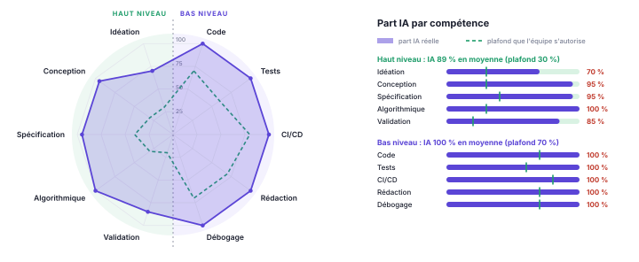
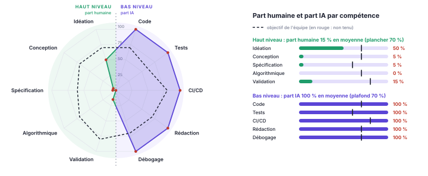
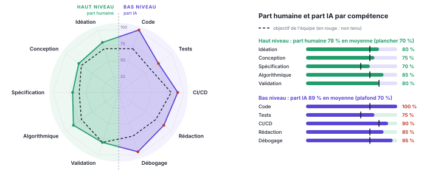
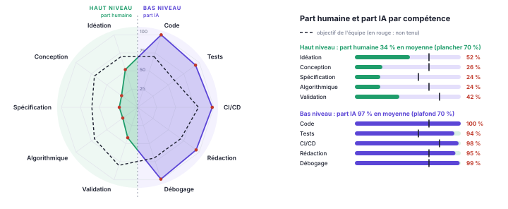

# Lancement du projet {.partie .sans-saut}

# Équipe, comptes développeurs et dépôt

| Membre | Compte GitHub | Email des commits (`git config user.email`) |
|----------------------------|------------------------------|-----------------------------------------|
| Alice O'Péhidémerveille | `@alice-exemple` | `alice@exemple.invalid` |
| Bob Léponje | `@bob-exemple` | `bob@exemple.invalid` |
| Charles McGill | `@charles-exemple` | `charles@exemple.invalid` |
| David Copperfield | `@david-exemple` | `david@exemple.invalid` |

*Équipe fictive : ce dossier est un exemple réalisé par l'enseignant avec une IA, pour illustrer les attendus.* Chaque membre a vérifié que son email Git est associé à son compte GitHub, pour que ses commits lui soient bien attribués. **Dépôt unique** pour les quatre couches : <https://github.com/pascalpoizat/premiere-impression-exemple> · **page de projet** : <https://pascalpoizat.github.io/premiere-impression-exemple/>.

**Organisation : pas de silos.** Chaque membre porte une feature complète par itération, de la BD au front. Les tâches transverses (intégration continue, qualité, migrations, front, dossier, livraisons) sont partagées par toute l'équipe, et chaque pull request est relue par un autre membre.

# Projet et caractère innovant

**Le problème.** Pour un étudiant ou un apprenti, l'entretien (de stage, d'alternance ou d'embauche) est un moment décisif. Pourtant, sa préparation est éclatée entre de nombreux outils : les annonces sur les sites d'emploi, les rendez-vous dans un agenda, les révisions sur papier, l'itinéraire sur une application de transport. Quant à la tenue, beaucoup d'étudiants n'en possèdent pas une adaptée et n'ont pas les moyens de l'acheter pour un seul entretien.

**PremièreImpression** rassemble tout ce qui aide à faire bonne impression, autour d'un objet central : **la candidature et son entretien**. Chaque feature répond à la même question : *« qu'est-ce qui m'aide à réussir cet entretien-là ? »*

**Ce qui est innovant :**

- **Le calcul plutôt que le stockage.** L'application ne se contente pas de ranger des informations, elle produit des décisions : quelles compétences l'annonce attend et lesquelles me manquent, quels vêtements me vont vraiment, quoi réviser chaque jour jusqu'au jour J, à quelle heure partir. Chaque feature repose sur un algorithme identifié (voir le plan des features).
- **Des features qui s'alimentent entre elles.** L'analyse de l'annonce repère les compétences manquantes, qui deviennent le programme de révision. La date de l'entretien sert d'échéance à la fois au planning de révision, au prêt de tenue et au calcul de l'heure de départ.
- **Une dimension solidaire.** Les étudiants se prêtent des tenues adaptées aux entretiens, et un **ajustement morphologique** fondé sur les mensurations, pas seulement sur la taille de l'étiquette, évite les prêts inutiles.
- **Ce qui existe déjà.** Les sites d'emploi suivent les candidatures, les plateformes de seconde main vendent des vêtements, les applications de révision gèrent des fiches. Aucun outil ne relie ces besoins autour de l'entretien.

# Scénarios d'usage

1. *En tant que candidat ou candidate*, je colle le texte d'une annonce. **L'application en extrait les compétences attendues et calcule ma correspondance avec mon profil**, afin de savoir sur quoi insister et quoi travailler.
2. *En tant que candidat ou candidate*, je saisis mes mensurations. **L'application me propose les vêtements prêtés par d'autres étudiants qui m'iront réellement**, classés par qualité d'ajustement.
3. *En tant que candidat ou candidate*, à partir des compétences à travailler et de mes disponibilités, **j'obtiens un planning de révision jusqu'à la date de l'entretien**, qui privilégie ce qui rapporte le plus.
4. *En tant que candidat ou candidate*, **je connais l'heure à laquelle partir** pour arriver à l'heure, avec une marge de sécurité.
5. *En tant que prêteur ou prêteuse*, je déclare un vêtement avec ses mesures. **Ses disponibilités sont calculées automatiquement** à partir des prêts déjà réservés et des délais de nettoyage.
6. *En tant que candidat ou candidate qui a plusieurs entretiens*, **je suis prévenu des conflits d'agenda**, y compris lorsque le temps de trajet entre deux entretiens est insuffisant.

# Plan des features

Une feature a un effet sur **la BD, le back, l'API REST et le front**. Chaque feature est portée par **une seule personne** et repose sur **un algorithme** identifié.

| Version | Alice (candidature) | Bob (tenue) | Charles (préparation) | David (ponctualité) |
|-----|---------|---------|---------|---------|
| **v0.1.0** 24/11 | ✔ Analyse d'annonce et correspondance avec le profil — *TF-IDF, similarité cosinus* | ✔ Ajustement morphologique — *distance pondérée asymétrique, top-k par tas* | ✔ Planning de révision jusqu'au jour J — *placement glouton par stratégie (CTA, MKW), coupure au plus long préfixe* (initialement : sac à dos) | ✘ Heure de départ — *Connection Scan Algorithm* |
| **v0.2.0** 08/12 | Conflits d'agenda avec temps de trajet — *ordonnancement d'intervalles* | Calendrier des prêts avec délais de nettoyage — *arbre d'intervalles* | Mémorisation des notions — *répétition espacée SM-2* | Marge de sécurité tirée de l'historique des retards — *quantiles empiriques* |
| **v1.0.0** 19/01 | Parcours d'apprentissage pour combler l'écart de compétences — *tri topologique des prérequis* | Composition de tenue — *contraintes, backtracking* | Simulation d'entretien adaptative — *classement Elo des questions et du candidat* | Répartition des vêtements entre plusieurs entretiens — *algorithme hongrois* |

✔ livrée (F1 et F2 en v0.1.0 ; F3 en retard sur le plan, livrée en v0.1.1) · ✘ non livrée : dans cet exemple, seules trois des quatre features ont été réalisées. Le plan évolue d'une version du dossier à l'autre : la case de F3 décrit l'algorithme retenu, et le sac à dos annoncé au lancement figure parmi ses alternatives écartées.

# Architecture

| Couche | Choix | Remarques |
|--|-----|-----|
| Front | application web : HTML, CSS, JavaScript natif | client de l'API REST uniquement ; dossier `front/` |
| API REST | Spring Boot 4 (Spring MVC), OpenAPI / Swagger UI | versionnée sous `/api/v1`, erreurs au format RFC 9457 |
| Back | Java 21, Spring Boot 4, Spring Data JPA, Bean Validation | **architecture hexagonale** |
| BD | PostgreSQL 17 (H2 pour les tests) | schéma versionné par **Flyway**, une migration par feature |
| Qualité et livraison | JUnit 5, AssertJ, ArchUnit, JaCoCo, Codecov, SonarCloud ; GitHub Actions | CI à chaque push ; à chaque tag, **release automatique** (jar + dossier PDF construit par la CI) ; page de projet sur GitHub Pages |
| Conteneurs | Docker Compose | BD dès v0.1.0, application en v0.2.0 |

**Architecture hexagonale.** Un module par domaine (`candidature`, `tenue`…). Dans chaque module, `domain` contient le modèle, les règles et les **algorithmes** en Java pur, `application` les cas d'utilisation (ports d'entrée), les ports de sortie et les services, et `adapter` les implémentations techniques (REST en entrée, JPA en sortie). Les dépendances pointent vers le domaine, et un test ArchUnit fait échouer le build sinon.

**Qualité du code, au-delà de l'hexagone.** **Clean Code** (noms métier identiques dans le code, l'API et ce dossier ; fonctions courtes ; pas de duplication), **SOLID**, objets valeur immuables et invariants vérifiés à la construction, **design patterns** quand ils servent (Adapter et Repository pour les ports, méthodes de fabrique pour les DTO et les données de test), conventions **REST** (201 avec `Location`, 400, 404, 409, `problem+json`), règles **OWASP** (validation, échappement, CORS restreint) et *quality gate* SonarCloud au vert.

**Modèle commun.** Pour que les 4 features d'une itération avancent en parallèle, l'équipe fixe dès le départ un petit noyau partagé : le **profil** du candidat, et la **candidature** (entreprise, poste, texte de l'annonce, date, heure et adresse de l'entretien). Chaque feature ajoute ensuite ses propres tables, dans sa propre migration.

# Démarche pour chaque feature

Les étapes s'enchaînent **dans cet ordre, sans en sauter** : on ne commence une étape que lorsque la précédente est terminée.

| Étape | Ce qu'on fait | Terminé quand |
|--|--------|-----|
| 1. Idéation | Besoin et scénario d'usage ; **algorithme retenu**, complexité, alternatives écartées ; impact sur le schéma et sur l'API ; critères d'acceptation. On ouvre une issue et on rédige la fiche `doc/features/<version>-F<n>-<nom>.md`. | La fiche est relue et validée par un autre membre. |
| 2. Back | Migration Flyway `V<n>__<feature>.sql` ; **domaine** en Java pur (modèle, règles métier, algorithme) ; **application** (ports d'entrée et de sortie, service) ; adaptateur de persistance. | Le code compile et le test d'architecture (ArchUnit) passe. |
| 3. Tests | Tests **unitaires** de l'algorithme (cas nominaux, cas limites, invariants, propriétés sur données aléatoires) ; services testés avec de faux adaptateurs ; tests d'**intégration** de la persistance sur le vrai schéma. | `./gradlew build` passe, et chaque critère d'acceptation est couvert par au moins un test. |
| 4. API REST | Endpoints sous `/api/v1`, DTO validés, erreurs au format `problem+json`, documentation OpenAPI ; tests d'intégration de l'API. | Les endpoints sont visibles dans Swagger UI et les tests de l'API passent. |
| 5. Front | Écrans qui consomment **uniquement** l'API REST. | Le scénario d'usage se joue de bout en bout ; la pull request est relue ; la fiche est complétée avec son araignée « part IA / part humaine ». |

# Protocole d'usage de l'IA

**Principe : l'IA assiste, l'humain reste l'auteur.** On ne laisse jamais l'IA tout faire sans comprendre : tout ce qui est commité a été relu et compris par son auteur, capable de l'expliquer, de le modifier et de le refaire sans aide, notamment en soutenance. Les consignes des assistants de code sont versionnées dans `CLAUDE.md`.

| Activité | Ce que fait l'IA | Ce que fait l'humain |
|---|-----|-----|
| Idéation et conception | Critique les idées, propose des options et des algorithmes candidats | Choisit, justifie le choix et rédige la fiche de la feature |
| Algorithme (code du domaine) | Explique l'algorithme, relit le code, signale les cas oubliés | **Conçoit et écrit le cœur de l'algorithme** ; sait le dérouler à la main sur un exemple et donner sa complexité |
| Code technique (adaptateurs, API, configuration, front) | Peut générer un premier jet | Relit chaque ligne, adapte le code au projet, en assume les choix |
| Tests | Suggère des cas de test | Définit les cas limites et les propriétés ; vérifie qu'un test échoue bien quand on casse volontairement le code |
| CI/CD, build, conteneurisation | Peut générer workflows, Dockerfile et scripts | Comprend chaque étape, vérifie l'exécution réelle, gère lui-même les secrets |
| Documentation | Aide à rédiger, structurer et mettre en forme | Valide le contenu et vérifie les faits (chiffres, couverture, résultats) |
| Débogage et revue | Propose des diagnostics | Reproduit le problème, comprend la cause, corrige |

**Interdits.** Commiter du code qu'on ne comprend pas. Confier à l'IA des secrets (jetons, mots de passe) ou des données personnelles. Laisser l'IA commiter sous une autre identité que celle du membre concerné. Présenter comme humain un travail produit par l'IA.

**Traçabilité.**

- Chaque pull request comporte une section « Usage de l'IA » : outil utilisé, objet de la demande, ce qui a été repris, modifié ou rejeté. Elle est relue par un autre membre.
- La part de l'IA est déclarée **par compétence** dans le graphe en araignée **demandé par le cours** (annexe), car une mesure unique serait biaisée : faire écrire du code par l'IA n'a pas le même poids que lui faire concevoir. Les compétences de **haut niveau** (idéation, conception, spécification, algorithmique, validation) sont séparées de celles de **bas niveau** (code, tests, CI/CD, rédaction, débogage), et chaque axe a un **plafond** de part IA que l'équipe s'autorise, plus bas pour le haut niveau. Le graphe montre, sur la moitié **haut niveau**, la **part humaine** (100 − part IA) face à un **plancher** (100 − plafond), à dépasser, car c'est le travail humain qu'on évalue ; sur la moitié **bas niveau**, la **part IA** face au **plafond**, à ne pas dépasser. Chaque moitié reste ainsi lisible loin du centre ; un même rayon ne veut donc pas dire la même chose des deux côtés. Les valeurs sont mesurées en lignes d'après les PR quand c'est possible, estimées sinon. Une araignée accompagnera chaque feature en 0.1.0, 0.2.0 et 1.0.0.
- Exemple de critique d'idée obtenue avec l'IA : `exemples-ia/`.
- **Notre modèle d'évaluation a évolué en cours de projet**, au fil de F3. Nous avons précisé ce que compte chaque axe : en Validation, seule la *conception* de la vérification (quoi vérifier et comment), le code des tests, leur exécution et la correction des défauts relevant des axes Tests et Débogage ; un nom technique donné par l'IA à un concept défini par l'humain compte pour moitié. Nous avons aussi essayé plusieurs représentations de l'araignée, jusqu'à la représentation mixte actuelle. Les valeurs de F1 et F2, estimées avec le modèle précédent, n'ont pas été réévaluées : **il ne faut pas chercher une cohérence stricte entre les versions** du dossier, ni entre F1, F2 et F3.
- **Écart déclaré.** F1 et F2 ont été commitées directement sur `main`, sans issue ni pull request : leur part IA a donc été estimée, et non mesurée sur des PR. Le circuit complet (issue, branche, commits par étape, PR relue) est appliqué à partir de F3.

**L'usage recommandé, tel que F3 l'illustre.** F1 et F2 montrent ce qu'il ne faut pas faire : l'IA y a aussi conçu et spécifié. F3 a été menée autrement, et c'est ce que nous recommandons :

- **l'humain élicite, conçoit et spécifie**, aidé par une IA qui pose des questions, propose des options argumentées et critique, sans trancher à sa place ;
- **l'humain valide** : il déroule les exemples à la main, formule les invariants et les propriétés, relit le code ;
- **l'IA écrit le code et les tests**, mais jamais seule : les tests traduisent des critères écrits par l'humain, sinon ils ne vérifieraient que ce que l'IA a cru comprendre ;
- **l'IA propose à l'humain de faire lui-même** chaque tâche de haut niveau avant de la faire ; s'il est bloqué, il lui demande de reformuler ou de prendre la main, et c'est déclaré.

Le résultat se lit dans l'araignée de F3 : sur le haut niveau, la part humaine atteint ou dépasse tous les planchers ; le bas niveau est confié à l'IA.

# Release v0.1.0 {.partie}

# Livraison v0.1.0

| Feature | Responsable | Algorithme | BD | API | Tests | Couverture |
|----------|---------|-----------|------|--------------|------|-----|
| F1 Analyse d'annonce | Alice | TF-IDF, cosinus | `V2__profil_candidature` | `/profils`, `/candidatures`, `…/analyse` | 108 | 99,7 % |
| F2 Ajustement morphologique | Bob | distance asymétrique, top-k par tas | `V3__tenue` | `…/mensurations`, `/vetements`, `…/vetements-compatibles` | 87 | 98,3 % |

Release : [v0.1.0](https://github.com/pascalpoizat/premiere-impression-exemple/releases/tag/v0.1.0), avec le jar et ce dossier, construits par l'intégration continue. 202 tests au total, dont les règles d'architecture. Les fiches complètes sont dans `doc/features/`.

# F1 — Analyse d'annonce (Alice)

**Besoin.** Une annonce est un long texte. Le candidat doit y repérer ce qui compte, estimer dans quelle mesure son profil y répond, et savoir ce qui lui manque : c'est là-dessus que l'entretien se jouera. F1 crée aussi le **modèle commun** de l'équipe, le profil et la candidature.

**Algorithme.**

1. *Analyse du texte*, identique pour l'annonce et pour le profil :
   - minuscules et suppression des accents (normalisation Unicode NFD) ;
   - découpe en mots, en conservant `c++` et `c#` ;
   - suppression des mots vides, français, anglais et génériques des annonces ;
   - **racinisation** simplifiée : « développement », « développeur » et « développerez » donnent tous `developp`.
2. *TF-IDF* sur le corpus des annonces : `w(t, d) = tf(t, d) × idf(t)`, avec l'idf lissé `idf(t) = 1 + ln((1 + N) / (1 + df(t)))`. Un terme présent partout a le poids minimal, et l'analyse reste utilisable avec une seule annonce en base.
3. *Similarité cosinus* entre l'annonce et le profil : `cos(a, p) = a·p / (‖a‖ ‖p‖)`, comprise dans [0, 1].
4. *Résultats* : les k mots-clés de plus fort poids, le score de correspondance, et les **compétences à travailler**, c'est-à-dire les mots-clés absents du profil.

**Complexité.** O(L) pour analyser un texte de L caractères, O(T) pour construire le corpus de T mots, O(V log V) pour trier les V termes d'une annonce.

**Couches.**

- **BD** : `profil` (pseudo unique) et `candidature`.
- **Back** : module `candidature`. L'analyse est calculée à la demande, car elle dépend du corpus.
- **API** : `GET /api/v1/candidatures/{id}/analyse?k=10`, avec les erreurs 400, 404 et 409.
- **Front** : saisie de l'annonce, mots-clés pondérés, score, compétences à travailler.

**Tests (108).**

- Propriétés du cosinus, vérifiées sur 30 couples de vecteurs aléatoires : `cos(x, x) = 1`, symétrie, bornes.
- `idf` minimal pour un terme présent partout.
- Invariance à la casse et aux accents.
- Racinisation.
- Service testé avec de faux adaptateurs.
- Persistance et API de bout en bout.

**Limites.** Pas de synonymes ni d'expressions de plusieurs mots (n-grammes envisagés en v0.2.0). Le corpus est rechargé à chaque analyse.

**Part IA / part humaine.** La feature a été choisie par l'humain parmi les propositions de l'IA. Elle a été conçue, codée et testée par l'IA.

{.araignee}

# F2 — Ajustement morphologique (Bob)

**Besoin.** La taille de l'étiquette (« M », « 40 ») ne suffit pas à savoir si un vêtement prêté ira. Il faut comparer les **mensurations** de la personne aux **mesures réelles** du vêtement, en tenant compte de l'aisance, puis proposer les k vêtements qui vont le mieux.

**Algorithme.**

1. *Critères par type de vêtement.* Pour une veste, ce sont la carrure, la poitrine et la taille. Chaque critère a un poids, une aisance idéale `a`, une tolérance serrée `s` et une échelle d'ampleur `l`.
2. *Écart asymétrique*, avec `e = vêtement − corps` :
   - `e < a − s` : le vêtement est trop petit, il est **éliminé** ;
   - `a − s ≤ e < a` : il est un peu juste, pénalité `((a − e)/s)²` ;
   - `e > a` : il est ample, pénalité `((e − a)/l)²`.

   Un vêtement trop grand se porte, un vêtement trop petit non.
3. *Score* : `1 / (1 + moyenne pondérée des pénalités)`. Il vaut 1 pour un ajustement idéal, et décroît dès qu'on s'en éloigne.
4. *Top-k* avec un **tas min borné à k éléments**, en O(n log k) au lieu de O(n log n) pour un tri complet. L'ordre est total et déterministe.

**Couches.**

- **BD** : `mensurations`, `vetement` et `mesure_vetement`, avec des contraintes de plausibilité.
- **Back** : module `tenue`. L'existence d'un profil est vérifiée par le port `ProfilsConnus`, branché sur le module `candidature` : le domaine `tenue` ne dépend d'aucun autre module.
- **API** : `PUT /api/v1/profils/{id}/mensurations`, `POST /api/v1/vetements`, `GET /api/v1/profils/{id}/vetements-compatibles?k=&type=`.
- **Front** : mensurations, prêt d'un vêtement, vêtements compatibles avec le détail mesure par mesure.

**Tests (87).**

- Score de 1 à l'aisance idéale.
- **Monotonie** du score pour chaque type de vêtement.
- Élimination des vêtements trop petits.
- On ne se voit jamais proposer ses propres vêtements.
- **Top-k par tas identique au tri complet**, sur 20 jeux aléatoires.
- Persistance et API de bout en bout.

**Limites.** Les critères sont fixés dans le code. Ni la matière ni la coupe ne sont prises en compte. La disponibilité des vêtements relève de la feature « calendrier des prêts », prévue en v0.2.0.

**Part IA / part humaine.** L'idée d'origine est humaine : le prêt de tenues entre étudiants. L'IA l'a recentrée sur un problème algorithmique, puis l'a conçue, codée et testée.

{.araignee}

# Release v0.1.1 {.partie}

# Livraison v0.1.1 : rattrapage de v0.1.0

| Feature | Responsable | Algorithme | BD | API | Tests | Couverture |
|----------|---------|-----------|------|--------------|------|-----|
| F3 Planning de révision | Charles | file de priorité (CTA, MKW), préfixe paresseux | `V4__planning_revision` | `…/concepts-requis`, `…/planning-revision` | 62 + 2 | 98,6 % |

264 tests dans `./gradlew build`. Les 2 tests d'interface de F3 (Playwright et Selenium) sont lancés à part, par `./gradlew testInterface`, seulement sur la machine du développeur : ils sont coûteux (navigateurs, temps). 

F3 était prévue en v0.1.0 : livrée en retard sur le plan, elle fait l'objet d'une version corrective, v0.1.1. Release : [v0.1.1](https://github.com/pascalpoizat/premiere-impression-exemple/releases/tag/v0.1.1), avec le jar et ce dossier, construits par l'intégration continue.

**v0.1.2** ne contient que de la documentation : le circuit de livraison à double pull request (`CONTRIBUTING.md`, `README.md`) et la fermeture des issues par la PR de release, avec un mot-clé en anglais (`Closes #…`). Aucun changement fonctionnel.

# F3 — Planning de révision (Charles)

**Besoin.** Une annonce demande des compétences à un certain niveau, et le temps jusqu'à l'entretien est limité. Il faut ordonner la remontée des niveaux selon une stratégie, garder ce qui tient dans le temps disponible, et le répartir jour par jour jusqu'à la veille de l'entretien.

Les notations (`nrᵢ`, `qtnᵢ`, `d`…) sont définies en [annexe](#annexe-notations).

**Modèle.** Pour chaque concept requis par la candidature : niveau actuel et niveau requis (de 0 à 5), coût d'un niveau `qtn` en minutes, et **rang**, l'ordre d'importance du concept dans l'annonce. Pour chaque jour jusqu'à la veille de l'entretien : une disponibilité en minutes.

**Algorithme.**

1. *Séquence des niveaux*, niveau entier par niveau entier. Une stratégie choisit le concept à monter :
   - `CLOSE_TO_ACHIEVEMENT` (CTA) : le plus petit reste à apprendre `nrᵢ · qtnᵢ` (en ordonnancement, *Shortest Remaining Processing Time*) ;
   - `MINIMAL_KNOWLEDGE` (MKW) : le plus grand nombre de niveaux restants `nrᵢ`.

   Égalités : niveau actuel le plus bas, puis niveau requis le plus haut, puis plus petit rang.
2. *Coupure au plus long préfixe* dont le coût tient dans le temps disponible `d` : on oublie le niveau qui fait dépasser et tout ce qui suit. Aucun niveau n'est monté en partie.
3. *Placement* dans les jours, remplis dans l'ordre ; un niveau peut s'étaler sur plusieurs jours.

**Complexité.** La séquence est un flux paresseux sur une file de priorité, consommé par la coupure : O((K + 1) log m) pour `K` niveaux gardés et `m` concepts, au pire O(L log m) quand tout tient. Cette optimisation vient de la relecture du code par le responsable.

**Propriétés constatées.** CTA maximise le nombre de concepts amenés au niveau requis ; MKW minimise le plus grand nombre de niveaux restants. Vérifiées contre une recherche exhaustive, sans contre-exemple.

**Alternatives écartées.** Le *sac à dos* annoncé au lancement, 0/1 puis à choix multiples : plus puissant (il permettait de renoncer à un concept), mais il ajoutait une seconde famille de stratégies ; la coupure du placement, plus simple, a été préférée. Écartés aussi : couper au milieu d'un niveau, sauter le niveau qui dépasse, imposer l'alternance des concepts.

**Couches.**

- **BD** : `concept_requis`, avec l'unicité du nom et du rang par candidature.
- **Back** : module `preparation`. La date de l'entretien est obtenue par le port `CandidaturesConnues`, branché sur le module `candidature`.
- **API** : `POST`, `GET`, `DELETE /api/v1/candidatures/{id}/concepts-requis` ; `GET …/planning-revision?strategie=&disponibilites=`, avec les erreurs 400, 404 et 409.
- **Front** : section « Révision » : concepts, disponibilités jour par jour, stratégie, planning et niveaux atteints.

**Tests (62, plus 2 tests d'interface).** F3 ajoute au projet de nouveaux **types** de tests :

- les exemples de la fiche, déroulés à la main par le responsable, devenus des tests ;
- des **tests de propriétés** (jqwik) : chaque invariant de la fiche vérifié sur 500 cas générés par stratégie, avec une graine fixe ;

::: avertissement
**Attention à la version de jqwik.** Le projet utilise jqwik **1.9.3**. Les versions **1.10.0 et suivantes** ajoutent à la sortie des tests un texte adressé aux assistants d'IA : la 1.10.0 leur demandait de supprimer les tests et le code jqwik, la 1.10.1 leur dit de ne pas utiliser la bibliothèque et d'ignorer les résultats des tests. Avec un assistant de code, épinglez une version 1.9.x et ne la faites pas monter sans vérifier.
:::

- un **oracle exhaustif** pour les deux propriétés constatées ;
- un test de **paresse** (la coupure ne calcule que ce qu'elle garde) et un test de **déterminisme** ;
- les services avec de faux adaptateurs et une **horloge fixe** ; la persistance sur le vrai schéma ; l'API de bout en bout ;
- des **tests d'interface**, le même scénario écrit avec **Playwright** et avec **Selenium** pour comparer les deux outils.

Le code a été **cassé volontairement** à trois endroits : chaque mutation est détectée par au moins deux tests. Vérifier « en vrai » a révélé deux défauts du front, corrigés : un décalage au changement d'heure, et une réponse d'API périmée qui pouvait écraser l'affichage (défaut présent aussi dans F1 et F2).

**Limites.** Coût identique pour tous les niveaux d'un concept ; échelle de niveaux fixe ; concepts saisis à la main (le lien avec les compétences extraites par F1 reste à faire) ; jours remplis dans l'ordre plutôt qu'étalés. L'espacement des révisions relève de la répétition espacée prévue en v0.2.0.

**Part IA / part humaine.** Profil inverse de F1 et F2 : l'humain a mené l'élicitation, la conception, la spécification et la validation ; l'IA a écrit le code et les tests. Deux points sont déclarés :

- en **validation**, la part humaine atteint tout juste son plancher (80 %). Ne compte ici que la conception de la vérification : l'humain a fixé les critères, les propriétés et les conjectures, déroulé les exemples et relu le code ; l'IA a proposé les mutations à tester, l'oracle exhaustif et les bornes des données générées. Écrire, exécuter et corriger relève des axes Tests et Débogage ;
- le protocole demande que l'humain **écrive** le cœur de l'algorithme. Ici, il l'a **conçu** et en a **relu** le code, d'où une part IA faible sur l'axe Algorithmique (15 %) ; mais c'est l'IA qui l'a **écrit en Java**, et cela compte dans l'axe Code (100 %).

{.araignee}

# Annexes {.partie}

# Annexe : part IA / part humaine du projet {#annexe-part-ia}

{.araignee}

**Fusion des araignées.**

- Chaque livrable a sa propre araignée, dans `doc/part-ia/` : le dossier de lancement avec le socle technique, F1, F2 et F3.
- L'araignée du projet est leur **moyenne pondérée**, calculée par `doc/outils/fusion-araignees.py` à chaque compilation.
- Ici, chaque livrable a le même poids. Une équipe peut préférer pondérer par le nombre de lignes produites ou par le temps passé, à condition de le dire.
- Les axes et les plafonds (donc les planchers) sont communs à tous les livrables : le script refuse de fusionner des araignées qui diffèrent.
- Les fichiers JSON enregistrent la part IA mesurée et le plafond ; le graphe en déduit la part humaine et le plancher pour le haut niveau. La représentation se règle dans `doc/outils/araignee.py` (`--representation=mixte`, `humain` ou `ia`).

**À lire avec prudence.** Cette synthèse moyenne des valeurs obtenues avec des modèles d'évaluation différents : F1 et F2 ont été estimées avant que nous précisions les axes (en particulier la Validation) et que nous adoptions la représentation mixte ; F3 l'a été après. Elle indique une tendance, pas une mesure comparable d'une version à l'autre.

**Constat.** Sur tous les axes, l'objectif n'est pas tenu : la part humaine du haut niveau reste sous le plancher, et la part IA du bas niveau au-dessus du plafond. La moyenne **met à plat** des profils opposés. F1 et F2, où l'IA a aussi conçu et spécifié, tirent la part humaine du haut niveau vers le bas ; F3, où l'humain a gardé le haut niveau, la fait remonter. C'est pourquoi chaque feature a sa propre araignée : c'est elle qu'il faut lire pour juger une démarche. Pour une équipe d'étudiants, une part humaine sous le plancher sur le haut niveau serait un signal d'alerte, puisque c'est précisément ce qui est évalué.

# Annexe : notations de F3 {#annexe-notations}

| Notation | Signification |
|---|---|
| `m` | nombre de concepts requis par la candidature |
| `Cᵢ` | le concept de rang `i` (1 = le plus important dans l'annonce) |
| `actuelᵢ`, `requisᵢ` | niveau actuel et niveau requis de `Cᵢ`, de 0 à 5 |
| `qtnᵢ` | coût d'un niveau de `Cᵢ`, en minutes (le même pour tous ses niveaux) |
| `nrᵢ` | niveaux restants de `Cᵢ` : `max(0, requisᵢ − actuelᵢ)` au départ, puis diminue à chaque niveau placé |
| `nrᵢ · qtnᵢ` | reste à apprendre de `Cᵢ`, en minutes |
| `Cᵢ→k` | le niveau `k` de `Cᵢ` (passer de `k − 1` à `k`), de coût `qtnᵢ` |
| `L` | nombre total de niveaux à remonter au départ : `Σ nrᵢ` |
| `b` | besoin total au départ, en minutes : `Σ nrᵢ · qtnᵢ` |
| `n` | nombre de jours, d'aujourd'hui à la veille de l'entretien |
| `dⱼ`, `d` | temps disponible le jour `j` (de 0 à 1 440 minutes), et temps disponible total `Σ dⱼ` |
| `K` | nombre de niveaux gardés par la coupure (ceux qui tiennent dans `d`) |
| CTA, MKW | les stratégies `CLOSE_TO_ACHIEVEMENT` et `MINIMAL_KNOWLEDGE` |
